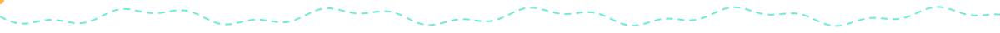

<div align="center">



<br/>

<a href="https://iremcagbayir.dev"></a>
<a href="https://cesium.com"></a>
<a href="https://perspectives-asso.fr"></a>

</div>

### 🛰️ `whoami`

```yaml
name:      Irem
based_in:  Montpellier, France  # 43.61°N, 3.88°E
role:      Geomatics Engineer · 3D Modeler · Web GIS Developer
mission:   turn raw spatial data into 3D experiences anyone can explore in a browser
speaks:    [Français, English, Türkçe]
currently: building solar & digital-twin tools for cities ☀️🏙️
```



### 🧭 How I work with spatial data



<table>
<tr>
<td width="33%" valign="top">

#### 🌍 3D Web GIS
CesiumJS globes, 3D Tiles, terrain & building models streamed to the browser.

</td>
<td width="33%" valign="top">

#### ☁️ LiDAR & point clouds
Classification, DTM/DSM, feature extraction, from raw scans to clean surfaces.

</td>
<td width="33%" valign="top">

#### 🏙️ City models & BIM
CityGML / CityJSON, BIM ↔ GIS integration, digital twins.

</td>
</tr>
<tr>
<td valign="top">

#### 🗄️ Spatial databases
PostGIS schemas, spatial indexing, geo-enabled REST APIs.

</td>
<td valign="top">

#### ☀️ Spatial analysis
Solar potential, shading, terrain, visibility and route analysis.

</td>
<td valign="top">

#### 📱 Field workflows
Mobile data collection with QGIS & GeoPackage, synced to the office.

</td>
</tr>
</table>


### 🧰 Toolbox

<div align="center">

**Geo** &nbsp;


<br/><br/>

**Code & 3D** &nbsp;
<br/><br/>


</div>


### 🚀 Featured projects

<div align="center">

<a href="https://github.com/GeoByteBrew/mon_soleil"></a>
<a href="https://github.com/GeoByteBrew/silent-wish-tree-montpellier-cesiumjs"></a>
<a href="https://github.com/GeoByteBrew/Route_Analysis_Toolkit"></a>
<a href="https://github.com/GeoByteBrew/city_app"></a>

</div>

<details>
<summary><b>🏗️ Professional work</b> (click to expand)</summary>
<br/>

- 🌬️ **Wind turbine platform design**: Civil 3D plugin automating platform design for wind farm projects
- 📍 **Field data collection**: geolocated site-visit workflow with QGIS, GeoPackage and Mergin Maps
- 🧊 **3D city & industrial modeling**: LiDAR + cadastral data → web-ready 3D buildings; LOD models for simulation

</details>


### 🤝 Community

| | |
|---|---|
| 🗺️ | **Founder & President, [Association Perspectives](https://perspectives-asso.fr)**: civic tech for accessible technology and participatory mapping |
| 👩‍💻 | **Mentor, Women in GIS**: supporting women entering the geospatial field |

### 📊 Activity

<div align="center">


</div>

<br/>

<a href="https://iremcagbayir.dev"></a>
